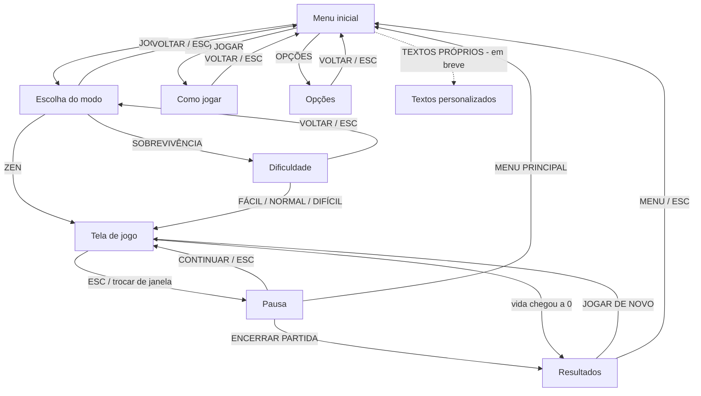

# TecTecTec — Protótipo de telas e fluxo de navegação (Semana 2)

## Fluxo de navegação



Toda a navegação funciona **só com o teclado** (setas + Enter + Esc), já que o jogador
está com as mãos no teclado o tempo todo. O mouse também funciona.

## Wireframes

```
MENU INICIAL                         ESCOLHA DO MODO / DIFICULDADE
+----------------------------------+ +----------------------------------+
|           TECTECTEC              | |         ESCOLHA O MODO           |
|  O TEOREMA DO MACACO INFINITO    | |                                  |
|                                  | |   [ SOBREVIVÊNCIA          ]     |
|        (macaco digitando)        | |     barra de vida...             |
|                                  | |   [ ZEN                    ]     |
|        [ JOGAR        ]          | |     infinito, sem vida           |
|        [ COMO JOGAR   ]          | |   [ VOLTAR                 ]     |
|        [ OPÇÕES       ]          | |                                  |
|        [ TEXTOS (breve)]         | |                                  |
|          RECORDE 1234            | |                                  |
+----------------------------------+ +----------------------------------+

TELA DE JOGO                         RESULTADOS
+----------------------------------+ +----------------------------------+
| MODO  PONTOS  ONDA  COMBO WPM VIDA| |        FIM DE JOGO               |
+----------------------------------+ |   SOBREVIVÊNCIA · NORMAL          |
|   banana        hamlet           | |        NOVO RECORDE!             |
|            [pri]mata  <- alvo    | | [PONTOS][ONDA][PALAVRAS][WPM]    |
|      soneto          x <- projétil| | [PRECISÃO][COMBO][TEMPO][RECORDE]|
|                                  | | +------------------------------+ |
|            (macaco)              | | | O MANUSCRITO DO MACACO       | |
|          [máquina]               | | | banana hamlet soneto ...     | |
+----------------------------------+ | | chance: 1 em 10^42           | |
| bônus ativos            ESC pausa| | +------------------------------+ |
+----------------------------------+ | [JOGAR DE NOVO]  [MENU]          |
                                     +----------------------------------+
```

## Regras implementadas no protótipo

| Regra | Como está hoje |
|---|---|
| Mira | A 1ª letra digitada escolhe o alvo (projéteis têm prioridade, depois o mais próximo) |
| Destruir | Completar a palavra; cada letra dispara um tiro e empurra a palavra para trás |
| Papel da máquina | Mostra o que já foi digitado da palavra em foco, com cursor; tecla errada pisca em vermelho |
| Apagar | Backspace apaga a última letra; Ctrl+Backspace apaga tudo. Sem letras digitadas, o alvo é liberado para mirar em outro |
| Celular/tablet | Teclado virtual abre ao iniciar a partida, ao tocar no jogo ou no botão TECLADO; botão PAUSA substitui o Esc; fonte das palavras cresce em telas pequenas |
| Recuo | Cada letra acertada empurra a palavra para trás, mas nunca para fora da tela |
| Teclado | Na tela de modo (e em Opções): ABNT2 traz palavras com acentos e ç; US traz tudo sem acento ("coração" → "coracao"). A escolha fica salva; sem escolha, tenta detectar o layout físico (Chrome) ou usa o idioma do navegador |
| Ondas | `4 + 2×onda` palavras por onda; palavras mais longas e rápidas a cada onda |
| Atiradores | A partir da onda 2 (Normal/Difícil): palavras rosa disparam letras vermelhas |
| Sobrevivência | Perde vida ao errar tecla, ao ser atingido por palavra ou por projétil |
| Zen | Sem vida; só encerra pelo menu de pausa |
| Pontuação | `letras × 10 × (1 + combo × 0,1)`; projéteis valem metade |
| Métricas | Pontos, onda, palavras, WPM (5 caracteres = 1 palavra), precisão, maior combo, tempo |
| Recordes | Salvos no navegador (localStorage) por modo + dificuldade |

## Dificuldades

| | Fácil | Normal | Difícil |
|---|---|---|---|
| Velocidade inicial | 24 px/s | 32 px/s | 58 px/s |
| Aceleração por onda | +5% | +7% | +12% |
| Intervalo entre palavras | ×1,2 | ×1 | ×0,65 |
| Palavras atiradoras | não | a partir da onda 2 | desde a onda 1, 1,5× mais frequentes |
| Velocidade dos projéteis | — | ×1 | ×1,4 |
| Dano (palavra / projétil / erro) | 15 / 8 / 1 | 20 / 10 / 2 | 25 / 15 / 4 |

## Bônus (estrutura pronta, sorteio na próxima etapa)

| Bônus | Efeito | Duração |
|---|---|---|
| Auto-completar | TAB termina a palavra em foco | 8 s |
| Escudo | Projéteis não causam dano | 10 s |
| Sem acentos | `a` vale por `á`, `c` por `ç` etc. | 12 s |

Para testar agora: abra `index.html?debug` e, durante a partida, use as teclas **1**, **2** e **3**.
